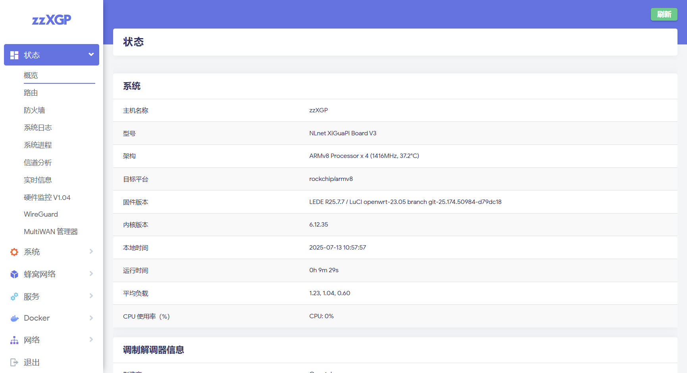

# NLnet XiGuaPi V3 (西瓜皮V3) LEDE 自动构建

> 本仓库基于 [zzzz0317/lede-xgp-auto-build](https://github.com/zzzz0317/lede-xgp-auto-build) 适配而来，
> 固定跟踪 [coolsnowwolf/lede](https://github.com/coolsnowwolf/lede) 的 **`master`** 分支，
> 并额外内置了 TD-TECH 模组支持与 AT WebServer（LuCI）组件。

## 本次适配变更

1. **跟踪 master 分支**：`prepare.sh` 使用 `git clone -b master --single-branch`，已存在的本地仓库也会强制 `checkout -B master` 并同步 `origin/master`。
2. **TD-TECH USB 模组支持**：`patches/999-add-TD-TECH-option-id.patch` 为内核 `drivers/usb/serial/option.c` 增加 TD-TECH（VID `0x3466`）多个 PID。`prepare.sh` 会读取 `target/linux/rockchip/Makefile` 中的 `KERNEL_PATCHVER`，把补丁动态放入 `target/linux/rockchip/patches-<内核版本>/`，内核升级后仍可自动适配（已在内核 6.18 上验证可直接应用）。
3. **AT WebServer / LuCI 内置**：`assets/at-webserver-ubus.zip` 中的 3 个 APK v3 包（at-webserver、luci-app-at-webserver、luci-i18n-at-webserver-zh-cn）已解包到 `overlays/at-webserver/`，在 `prepare.sh` 阶段作为 rootfs overlay 叠加进固件，无需在设备上额外安装。附 `zzzz-enable-at-webserver` uci-default 用于开机自动启用服务。
4. **config 重新生成**：`xgp.config` 已在 master 源码上执行 `make defconfig` 重新生成，清除了失效符号并把 `luci-app-opkg` / `luci-i18n-opkg-zh-cn` 更新为 master 上的新名 `luci-app-package-manager` / `luci-i18n-package-manager-zh-cn`；仍保持 **opkg**（`# CONFIG_USE_APK is not set`），因为 LEDE master 的 apk 打包链路不完整。
   - AT 网页入口：`http://<路由器IP>/5700/`
   - LuCI 菜单：服务 → MT5700 AT WebServer
   - 内置 Web 服务默认端口：WebSocket `8765`，模块 AT 端口 `192.168.8.1:20249`

## 已知问题

1. 对西瓜皮V3支持的变更已合并至 LEDE [8547db9c](https://github.com/coolsnowwolf/lede/commit/8547db9c25d697d9d966f8f8e91c6a74066ff243)
2. 通过转接板连接的 PCIe 5G 模块在刷机后需要断电（直接拔DC插头，拔市电那头要多等几秒电容放电）一次，否则大概率找不到模块，转接板硬件原因导致模块在重启时不能正常下电。

## 说明

1. 第一次使用建议通过 RKDevTool 刷入，若通过 Web 刷入时提示不兼容请做好 USB 救砖准备再尝试
2. [Actions](https://github.com/hexos/lede-xgp/blob/master/.github/workflows/build.yml) 手动触发拉取 [LEDE](https://github.com/coolsnowwolf/lede) 的 `master` 分支代码编译并发布
3. 默认 Wi-Fi SSID: `zzXGP`，密码: `xgpxgpxgp`
4. 默认 LAN 接口地址: `10.0.0.1`
5. 默认 root 密码: `password`，后续可能会变更
6. 使用 PCIe 模块在刷机后建议断一次电

本固件目前的用途：

1. ~~合进LEDE主线，让所有人更容易的编译~~（已完成）
2. ~~测试模块兼容性~~（差不多完成了）
3. 收集建议添加新软件包

未来规划：

1. ~~周更，每周使用最新LEDE代码编译~~（已实现）
2. 自建软件仓库
3. 尝试其他OpenWRT分支

## 截图

## TODO

* [ ] 在线更新检查
* [ ] LEDE 代码更新检查

## ⚠️ 免责声明

1. **项目性质说明**  
   本项目在 GitHub Actions 自动编译过程中：
   - 实时拉取 [LEDE](https://github.com/coolsnowwolf/lede) 源码，和其它组件源码
   - 仅添加本仓库中的**公开可审查内容**

2. **设备风险自担**  
   - 任何因使用本项目固件导致的设备故障/变砖/安全问题
   - 任何因配置不当产生的网络风险或数据损失
   - 任何因第三方源码更新引发的兼容性问题
   **均与项目作者无关**，使用者需自行承担全部风险。

3. **使用限制条款**  

   ✅ **允许**：
   - 个人非商业用途
   - **免费、免授权**用于销售设备（预装固件）
   - **免费、免授权**用于技术服务（如刷机）

   ❌ **禁止**：
   - 将本仓库发布的固件文件作为付费商品单独销售

   ⚠️ **关键要求**：  
   当设备购买者/服务对象遇到：
   - 硬件故障
   - 网络配置问题
   - 非本项目导致的软件异常

   卖方/服务方必须自行提供技术支持，严禁将用户引导至本项目寻求帮助

4. 使用本项目即代表您**已充分理解并接受**：

    - 作者不对固件功能作任何明示/暗示担保
    - 任何商业使用产生的责任与作者无关
    - 违反使用条款造成的法律纠纷需自行承担

## 恰饭

[来个一键三连加关注呗](https://www.bilibili.com/video/BV1dU31ziEQf/)
